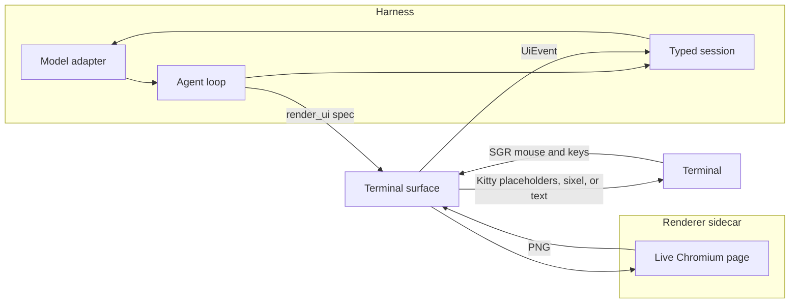

# Glimmer

A small agent harness whose terminal transcript draws **live HTML components** instead of dumping menus as markdown. The model calls `render_ui`. A headless Chromium page stays open for that card, the page is rasterized, and the bitmap is placed inline with the Kitty graphics protocol. Clicks, hover, scroll, and typing are real DOM events. Each completed action comes back as a typed session turn:

```ts
{ role: "user", event: { componentId, action, value } }
```

If the terminal cannot show Kitty graphics, the same components render as text and emit the same events.

## Architecture



The sidecar (`src/sidecar.ts`) is the only module that imports Playwright. The harness talks to it through `open`, `dispatch`, `refit`, and `play`. A pi extension could host that same interface later; nothing here imports pi, Hermes, or oh-my-pi. See [docs/research.md](docs/research.md) for why pi's session model is the base and why the monorepo is not vendored.

Components: choice list, form, approval card, table, bar chart, diff, and a constrained HTML snippet. Choice, form, and approval wait for the user, then freeze. Chart and diff are display-only. Frozen cards keep their last frame and ignore input.

## Setup

Node 22 or newer.

```bash
npm install
npx playwright install chromium
npm test
npm run demo -- --script --render text
npm run gallery
```

`npm run demo` with a TTY opens the alt screen. It uses a deterministic mock model unless an API key is set:

| Variable | Effect |
| --- | --- |
| `OPENAI_API_KEY` or `GLIMMER_API_KEY` | OpenAI-compatible chat completions |
| `GLIMMER_BASE_URL` | API base, default `https://api.openai.com/v1` |
| `ANTHROPIC_API_KEY` | Anthropic Messages API |
| `GLIMMER_PROVIDER` | `openai`, `anthropic`, or `mock` |
| `GLIMMER_MODEL` | Model name |
| `GLIMMER_RENDER` | `auto`, `text`, `kitty`, `kitty-unicode`, `kitty-direct`, `sixel` |

`--mock` forces the scripted model. `--script` plays the release demo by itself: branch list, form, approval. `--mouse pixel` enables SGR pixel hit testing (xterm 1016) on terminals that support it.

## Supported terminals

| Terminal | Graphics | Notes |
| --- | --- | --- |
| Kitty | Unicode placeholders | Best path. Images are grid text, so they scroll with the transcript. |
| Ghostty | Unicode placeholders | Full Kitty graphics protocol, including placeholders. |
| WezTerm | Direct Kitty placement | Placeholder support is not in a stable release yet, so Glimmer places at the cursor and deletes old placements before each frame. |
| xterm, foot, mlterm, WezTerm | Sixel via `--render sixel` | 64-color encoder. Coarser than PNG. |
| Anything else | Text | Same events, keyboard and cell clicks. |

Auto detection checks `KITTY_WINDOW_ID`, `GHOSTTY_RESOURCES_DIR`, `TERM`, and `WEZTERM_PANE`. Inside tmux, Kitty sequences are wrapped for passthrough; the tmux config still needs `allow-passthrough on`.

## Known limits

- The live session uses the alternate screen so hit testing has a stable viewport. On exit, Glimmer prints the transcript into the normal buffer. That is the scrollback copy. Resizing during the session refits live pages; frozen bitmaps are rescaled rather than reflowed.
- Direct placement and sixel can clip a card whose top has scrolled off the viewport. Unicode placeholders do not.
- Hover tracking (`1003`) re-rasterizes on a short debounce. Typing feels like a local page, with about one frame of screenshot delay.
- Pixel-perfect hits need `--mouse pixel`. The default aims at the center of the cell, which is enough for these full-width controls.
- Constrained HTML is stripped of scripts and remote URLs. That is a prototype filter, not a security boundary.
- One card has keyboard focus at a time. Esc returns to the composer. IME composition is not forwarded.
- Sixel is a fallback, not a second design. Ghostty does not implement it.

## Demo script

The mock model asks which branch, then for a PR title and notes, then for approval, then shows a diff and a risk chart. A follow-up typed into the composer is answered without another card. With a real key, the same system prompt asks the model to follow that sequence and to read `ui-event` blocks.

## Tests

`npm test` covers pointer mapping, Kitty placeholder encoding, text-widget keyboard handling, and the session plumbing the demo uses. `npm run gallery` writes light and dark PNGs of every component.
